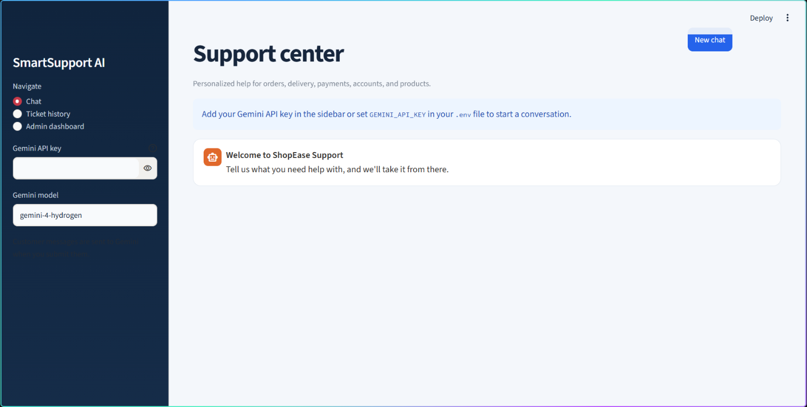
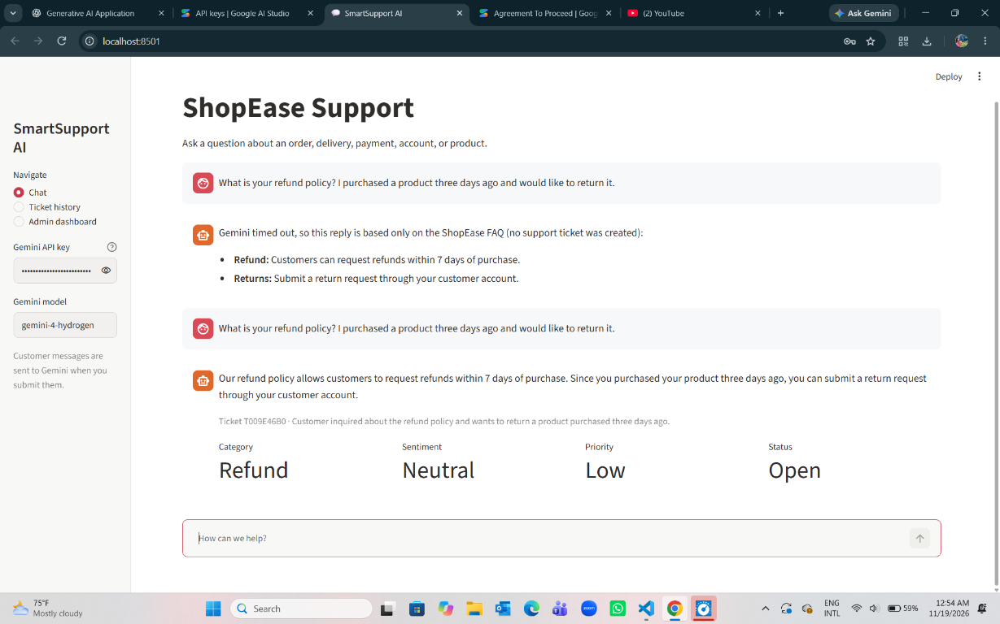
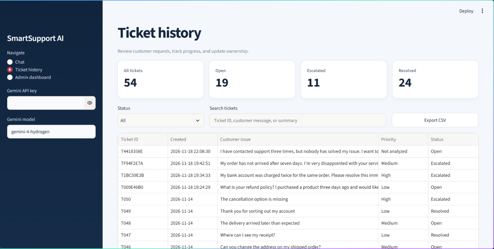
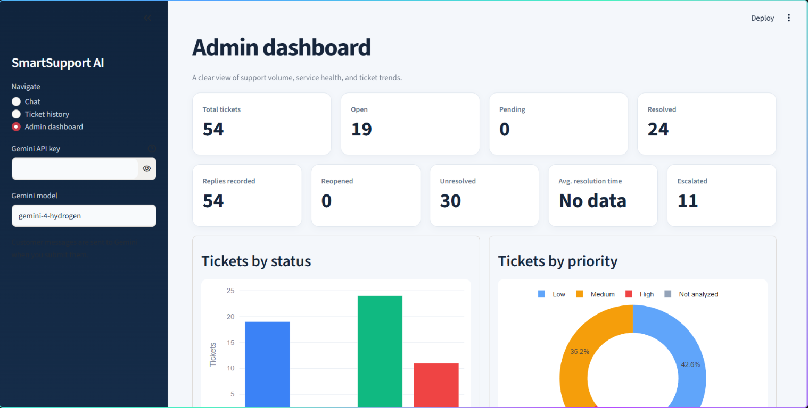

# SmartSupport AI

A beginner-friendly customer support assistant for the fictional ShopEase store. It uses Streamlit for the interface, Gemini for AI-generated responses and ticket analysis, CSV files for the FAQ and sample tickets, and SQLite for persistent ticket storage.

## Features

- A polished, responsive interface with a consistent support-center theme across chat, ticket history, and analytics.
- Gemini answers customer questions using the ShopEase FAQ as prompt context.
- Gemini inquiries are classified by category, sentiment, and priority, summarized, and checked for human escalation. FAQ-only fallback inquiries are saved as Open tickets, with sentiment and priority marked "Not analyzed."
- New inquiries are saved to SQLite and appear in ticket history and the admin dashboard.
- Chat history is restored for the conversation URL; customers can rate responses.
- Ticket history supports status updates, assignment, search, and CSV export.
- The dashboard visualizes ticket volume by status, priority, category, sentiment, and date, plus reply, reopen, unresolved, and resolution-time metrics.
- Fifty synthetic tickets provide sample dashboard data before customers submit new requests.

This is a simple knowledge-grounded chatbot, not a vector-search or model-training project. Gemini output can be incorrect; review escalated or sensitive cases before acting on them.

## Live app

Use [Deploy SmartSupport AI to Streamlit Community Cloud](https://share.streamlit.io/deploy?repository=nipunidasanayake%2FSmartSupport-AI&branch=main&mainModule=app.py) to create a public deployment. After deployment, add the generated `https://<app-name>.streamlit.app` address here as the live app link.

### Deploying

1. Sign in to [Streamlit Community Cloud](https://share.streamlit.io/) with GitHub.
2. Open the deploy link above and select `nipunidasanayake/SmartSupport-AI`, branch `main`, and `app.py` as the entry point.
3. Select **Deploy**. When the deployment finishes, copy its `streamlit.app` URL to use as the live app link.
4. Add `GEMINI_API_KEY` to **Advanced settings > Secrets**, or enter your own Gemini API key in the app sidebar. The app does not save the sidebar value in the database.

**Public demo warning:** The app has no login or access control. Tickets, messages, chat history, and dashboard data are shared with anyone who opens the deployment. Do not enter real customer or sensitive information. The SQLite database is local to the app instance and may be reset when the hosted app restarts or redeploys.

## Setup

1. Use Python 3.10 or later and create and activate a virtual environment:

   ```powershell
   python -m venv .venv
   .\.venv\Scripts\Activate.ps1
   ```

   If PowerShell blocks activation, use `.\.venv\Scripts\python.exe` instead of `python` in the commands below.
2. Install dependencies:

   ```powershell
   python -m pip install -r requirements.txt
   ```

3. Copy `.env.example` to `.env` and add a Gemini API key from [Google AI Studio](https://aistudio.google.com/):

   ```text
   GEMINI_API_KEY=your_real_api_key
   ```

   Alternatively, enter the key in the app sidebar. The app does not save that sidebar value. Do not commit `.env` or share API keys.

4. Start the app:

   ```powershell
   streamlit run app.py
   ```

The default model is `gemini-4-hydrogen`; change the model name in the sidebar if your API account uses a different available model. Customer messages are sent to Gemini when submitted.

## Project files

```text
app.py
requirements.txt
.env.example
.gitignore
tests/
  test_app.py
data/
  faq_knowledge_base.csv
  customer_tickets.csv
database/
  support_tickets.db       # Created on first launch; ignored by Git
docs/
  FINAL_REPORT.md
  screenshots/
```

The FAQ CSV contains 30 entries. The historical ticket CSV contains 50 synthetic entries. On first launch, the app imports those tickets into SQLite; later launches keep the database contents and do not re-import the sample rows.

## Using the app

- **Chat:** Submit a customer question to get a response and ticket analysis. Inquiries marked for escalation are saved with `Escalated` status; other new inquiries start as `Open`. Gemini is tried first; the FAQ is used only after a timeout.
- **Chat history:** The conversation ID is stored in the URL so the same conversation can be restored after a page refresh. Treat conversation links as private; this local demo does not include user authentication.
- **Ticket history:** Search tickets, filter by status, update status or assignee, and export the filtered results as CSV.
- **Admin dashboard:** View ticket totals, status, reply, reopened, unresolved, and resolution-time metrics plus charts. The dashboard works without an API key.

With a valid API key, Gemini is always tried first. Temporary HTTP 429 rate limits are retried with exponential backoff within the 60-second request budget. If Gemini still times out or returns HTTP 504, the app uses a matching FAQ answer when available; if no FAQ matches, it saves an Open ticket. Missing or rejected keys, unavailable models, and other non-timeout failures do not use FAQ content: the app shows the reason and saves an Open ticket instead. Fallback tickets are labeled, and their sentiment and priority are marked "Not analyzed."

## Demo walkthrough

1. Start the app and enter a valid Gemini API key in the sidebar. Without a key, Gemini cannot answer; the app explains the issue and saves questions as Open tickets. FAQ fallback is reserved for timeouts.
2. In **Chat**, ask a ShopEase question such as "How can I return an item?" The app displays the reply and ticket analysis, including category, sentiment, priority, summary, and escalation status.
3. Open **Ticket history** to find the newly created ticket, review its details, and change its status or assignee.
4. Open **Admin dashboard** to show the ticket totals and charts. New chat inquiries are reflected in the dashboard.

Use **New chat** to start a fresh conversation. It also clears a failed pending request so it cannot block the next question.

## Screenshots

These screenshots show the Chat workflow, a Gemini response example, Ticket history, and the Admin dashboard.

### Chat



### Gemini response example

This conversation shows an FAQ timeout fallback followed by a Gemini-generated response. The fallback message reflects an earlier app version; the current version creates an Open ticket when the timeout fallback is used.



### Ticket history



### Admin dashboard



## Tests

Run the local regression suite with:

```powershell
python -m unittest discover -s tests -v
```

The tests cover database migration, ticket workflow, feedback persistence, conversation history, Gemini-failure and missing-key fallbacks, New chat state reset, and dashboard/ticket-history rendering. They use a temporary database and do not call the live Gemini API.

To start over with the original sample tickets, stop the app and remove `database/support_tickets.db`. The app will recreate it from `data/customer_tickets.csv` on its next launch.
