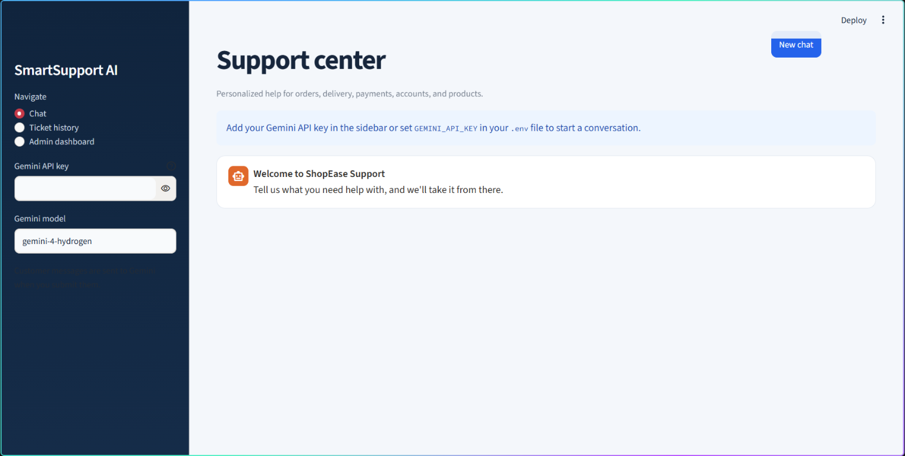
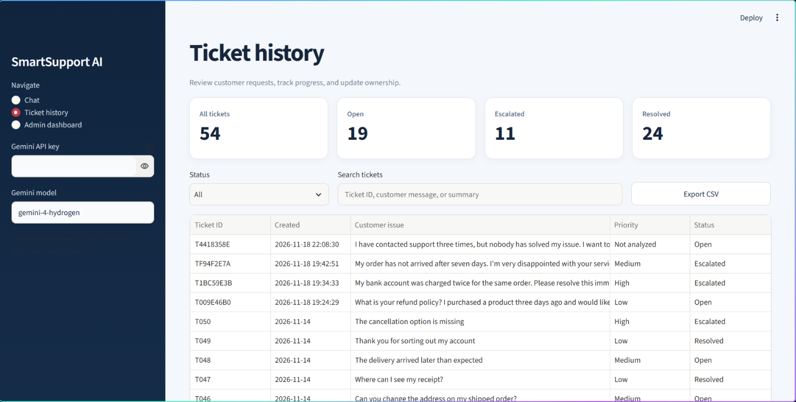
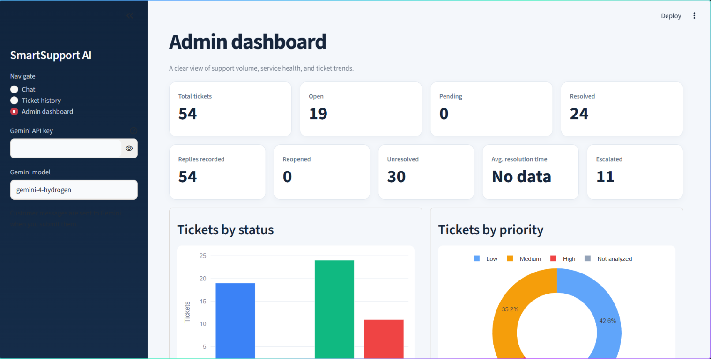

# SmartSupport AI — Implementation Report

## Summary

SmartSupport AI is a local Streamlit customer-support demo for the fictional ShopEase store. It uses Gemini for customer replies and ticket analysis, a CSV FAQ knowledge base, and SQLite for tickets and chat history.

## Roadmap delivery

- **Project setup and datasets:** Python environment, dependencies, FAQ dataset, historical ticket dataset, and API-key configuration are documented.
- **Gemini integration:** The tested default model is `gemini-4-hydrogen`. Gemini-generated questions receive a response and ticket analysis. If the key is missing or Gemini is unavailable, the app uses a matching FAQ or saves an Open fallback ticket.
- **Ticket analysis:** Gemini supplies category, sentiment, priority, summary, and escalation recommendation. When Gemini is unavailable or no API key is configured, the app answers from matching FAQs or saves an Open ticket with a clear fallback response. Fallback tickets are labeled, and their sentiment and priority are marked “Not analyzed.”
- **Database:** SQLite stores tickets, response source, feedback, assignee, channel, status, reopen count, resolution time, and conversation ID. Existing databases are migrated without deleting their tickets.
- **Interface:** Chat, ticket history, and analytics share a polished color system, responsive spacing, card-based metrics, and clearer page hierarchy.
- **Chat UI:** The app displays a greeting, supports new conversations, restores a conversation from its URL, and stores thumbs-up/down feedback.
- **Ticket history:** Tickets can be searched, filtered, exported to CSV, reviewed in a focused table, assigned, and moved among Open, Pending, Resolved, and Escalated.
- **Admin dashboard:** The dashboard includes ticket counts, replies, reopened and unresolved counts, resolution time, and consistently styled status, priority, category, sentiment, and date charts.
- **Documentation and tests:** Setup and usage are in the README; regression tests use a temporary SQLite database and do not call the live Gemini API.

## Validation

Run the automated checks from the project root:

```powershell
python -m unittest discover -s tests -v
```

The suite covers model default, legacy database migration, successful chat persistence, missing-key and Gemini/network-error fallbacks, New chat state reset, conversation history, ticket status/reopen tracking, feedback persistence, and ticket-history/dashboard rendering. Python syntax compilation also passes. The user manually confirmed that Gemini returned a response in the app using `gemini-4-hydrogen`.

## Demonstration

The demonstration starts in Chat with a ShopEase customer question, then shows the generated reply and ticket analysis. The ticket appears in Ticket history, where its status and assignee can be managed. The Admin dashboard summarizes the same ticket data with status and category charts and other support metrics. If Gemini is unavailable, the app uses a matching FAQ or creates a clearly labeled Open ticket; sentiment and priority are marked "Not analyzed." New chat resets the conversation and any failed pending request.

## UI screenshots

The screenshots below show the Chat, Ticket history, and Admin dashboard pages in the running app.

### Chat



### Ticket history



### Admin dashboard



## Limitations and follow-up

- This is a local demo, not a production support system: it has no login or role-based access control. Conversation IDs are kept in the URL, so treat conversation links as private.
- Assignee is free text and the channel is currently always Chat; there is no agent directory or multi-channel ingestion.
- Historical sample rows do not include resolution timestamps or reopen events. Resolution-time and reopened metrics will become meaningful as tickets are managed in the app.
- The Streamlit UI implements the reference workflows, but is not a pixel-for-pixel reproduction of the supplied third-party mockups.
- Gemini availability, quota, and response quality depend on the configured Google AI Studio project and model.
